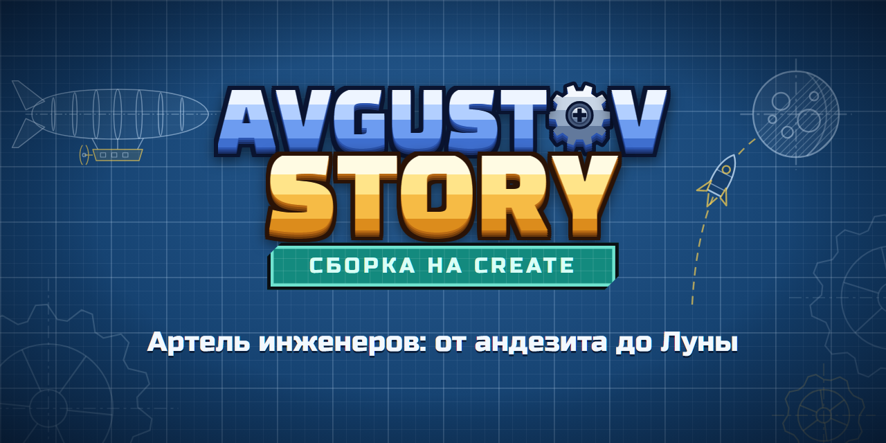

# AvgustovStory

**Сборка Minecraft 1.21.1 про артель инженеров.** Всё строится вокруг Create, а к ней добавлены сюжет и больше 700 квестов, переработанный мир и выживание, где важны еда, вода и климат.

**[⬇ Скачать последнюю версию](https://github.com/Avgust0v/Avgust0vStory/releases/latest)**

| | |
|---|---|
| Версия игры | Minecraft 1.21.1, NeoForge 21.1.265 |
| Модов | больше 400 |
| Язык | русский: квесты, сюжет и переводы модов |
| Для кого | компания до 8 друзей на своём сервере, можно играть и одному |
| Память | 12 ГБ |

---

## Идея

Главное правило сборки: **каждый мод должен подходить Create** по механике и по стилю. Это индустрия, механизмы, пар, поезда и автоматизация. Если мод под сомнением, его в сборке нет. Поэтому здесь нет магии с заклинаниями, фабрик ресурсов из воздуха и модов, которые делают Create ненужным.

Прогресс идёт **по эпохам**. Ключевым машинам каждой эпохи нужен продукт предыдущей. Рецепты меняются только через ингредиенты, предметы не блокируются, поэтому пропущенный квест ничего не ломает.

## Сюжет

Мастер Август основал артель инженеров и в начале каждой эпохи пишет ей письмо. Письмо приходит настоящей книгой, а по экрану проходит титр новой главы.

Вы не первые на этой земле. Задолго до вас здесь работала **Первая артель**. Она выкачала землю досуха во время «Великой выработки», её стражи обезумели, а ученики стали разбойниками-иллагерами. В конце Первая артель улетела к звёздам и оставила просьбу: «стройте мудрее нас».

- **Хроника Предтеч.** 12 страниц летописи мастера Ратибора, последнего летописца Первой артели. Каждая страница привязана к настоящей постройке или боссу. За страницу дают карту с крестом к следующему месту.
- **Стражи Предтеч.** Восемь древних стражей: Кованый рыцарь, Незеритовое чудовище, Левиафан, Сцилла, Маледиктус, Заклинатель, Древний остаток, Эндер-страж.
- **Записки Первой артели.** 13 записок мельника, кузнеца, смотрителя порта, горного мастера и других. Они спрятаны в сундуках руин и складываются в отдельные истории.
- **Финал** — ракета, полёт на Луну и эпилог «История артели».

## Эпохи

| Эпоха | Что открывает |
|---|---|
| 0. Первые шаги | Деревня, путевой камень, рюкзак, первый андезитовый сплав |
| 1. Андезит | Кинетика, жернова, прессы, ремни, поршни, первые машины в движении |
| 2. Незер и латунь | Горелка всполоха (для неё нужно поймать ифрита), латунь, первые корабли и дирижабли |
| Суша, море и небо | Машины, лодки, подлодки, воздушные шары, пропеллеры, джетпаки |
| 3. Фабрика и ток | Склады и посылки Create 6, электричество |
| 4. Пар и рельсы | Механизм точности, паровые машины, поезда, банк |
| 5. Сталь и нефть | Доменная печь, сталь, нефть, дизель, бесконечные жилы руды |
| 6. Трофеи боссов | Оружие и доспехи из трофеев, незеритовый бур |
| 7. Космос | Ракета, скафандр, Луна. Марс и Венера по желанию |

Несколько «ворот» держат порядок эпох: сталь варится только в доменной печи, незерит доступен только после стали, а самые дорогие вещи (рюкзаки, магниты, джетпак, элитры) собираются на машинах Create.

## Квесты

**Больше 700 квестов в 24 главах**, примерно половина из них необязательные. Все предметы, мобы и постройки из квестов проверены на тестовом сервере.

- **Путь инженера:** справочник, Хроника Предтеч, главы эпох, «Суша и море», «Небо».
- **Ремёсла и жизнь:** кухня, вода и климат; звери, рыбалка и фермы.
- **Поселения:** жители и торговля, **Биржа контрактов** (повторяемые заказы за монеты), **Лавка артели** (покупки за монеты и жетоны боссов).
- **Приключения:** исследование мира, арсенал, оружие, доспехи, подземелья и мини-боссы, боссы.

Около 90 квестов работают как **учебник Create**: в них есть разделы «Как работает» и «Зачем», а справочник объясняет нагрузку, скорость, подачу предметов и обработку руды.

## Create и техника

- **Энергия и промышленность:** Create Crafts & Additions, Create: New Age (электричество и реактор), TFMG (сталь, нефть, пластик, платы), Diesel Generators, Broken Bad (химия), Ore Excavation.
- **Логистика:** Factory Logistics, Mobile Packages, Vibrant Vaults, Storage Drawers, Sophisticated Backpacks и Storage с интеграцией Create.
- **Поезда:** Steam 'n' Rails, Blocks & Bogies, Railways Navigator, Tweaked Controllers.
- **Транспорт на физике:** **Create Aeronautics**. Корабли и дирижабли до 16 000 блоков собираются из настоящих блоков и летают на пропеллерах. Ещё есть подводные лодки Create Deep Seas, горки, джетпак и крюк-кошка.
- **Оружие:** Create Big Cannons и Create: Gunsmithing.
- **Космос:** Creating Space — ракеты, скафандры, Луна, Марс, Венера.
- **Экономика:** монеты-шестерни Create: Numismatics, банк, торговля с жителями на автоматике.
- **Десятки машин и деталей:** Create Connected, Enchantment Industry, Radars, Hypertube, Big Contraptions, органы Sound of Steam и другие.

## Мир

- **Рельеф и биомы:** Terralith, Biomes O' Plenty, Tectonic, Climate Rivers. Ручьи текут с гор, а по часто хоженым местам вытаптываются тропы.
- **Постройки:** When Dungeons Arise, YUNG's, Create: Structures Arise и Pillagers Arise (разбойничьи посёлки и дирижабли), Moog's Structures, Structory, Explorify, крупные деревни CTOV, Philip's Ruins, Ancient Remnants и десятки других.
- **Мелких построек много, больших подземелий мало.** Мелочь в стиле Create встречается часто и оживляет мир. Большое подземелье должно быть событием.
- **Незер и Край:** Incendium, Eternal Nether, Nether Depths Upgrade, Nullscape, Unusual End.
- **Небо и время:** длинные сутки (Better Days), кровавая луна и луна урожая, полярные сияния.
- **Чем дальше от центра, тем опаснее и богаче.** Мобы сильнее с каждым кольцом расстояния и с каждой эпохой. В сундуках далеко от спавна лежат книги высоких уровней, алмазы, редкие шаблоны и осколки сердца.
- **Lootr:** у каждого игрока свой сундук, поэтому лут и записки находит каждый.

## Выживание

- **Legendary Survival Overhaul:** жажда, температура и раны по частям тела.
  - Воду нужно очищать. Пить можно не только воду: соки, чай, молоко и коктейли утоляют жажду сильнее, а супы, салаты, фрукты, овощи и десерты тоже дают немного воды.
  - Супы и горячие напитки греют, соки и десерты охлаждают. Для жарких и холодных мест шьют подкладки к броне.
  - Раны сами заживают медленно, а сон лечит их только отчасти, так что бинты и аптечки нужны всерьёз. Тяжёлые раны дают дебаффы: удар по голове — головная боль и тошнота, по рукам — усталость и слабость, по груди — уязвимость, по ногам — медлительность.
- **Сердца за еду.** Игра начинается с 8 сердец, максимум 20.
  - Каждое новое блюдо даёт очки гурмана, и чем сложнее его приготовить, тем больше очков: печь и костёр — 1, разделочная доска — 2, котелок, машины Create, бочки и пиры — 3.
  - Сердце прибавляется на 10, 15, 35 … 360 очках. За этапы дают кухонные звания, от «Поварёнка» до «Легенды кухни».
  - Пир — общий стол: порция засчитывается всей гильдии рядом.
  - Смерть отнимает сердце, его нужно отъесть заново.
- **Рацион.** Пять групп еды: мясо, рыба и яйца; овощи и фрукты; хлеб и злаки; сладкое; напитки. Разнообразие последних 10 приёмов пищи даёт Спешку, Силу и Сопротивление, а однообразие — Слабость. Одно и то же блюдо 8 раз подряд «приедается».
- **Кухня:** Farmer's Delight и его дополнения, Create Central Kitchen, Slice & Dice, вино, пиво и кондитерская.
- **Параплан** (Paragliders) с выносливостью и Статуями Богини, надгробие с вещами после смерти.

## Бой и боссы

- **Ступени снаряжения T0–T6.** Броня и оружие из десятка модов сведены в одну систему: Epic Knights, Immersive Armors, Fantasy Armor и Weapons, Basic Weapons, молоты Just Hammers. Ступень и эпоха подписаны на каждой вещи, с T2 броня добавляет ещё и здоровье.
- **Около 70 боссов на лестнице B1–B6:** Cataclysm, Mowzie's Mobs, Legendary Monsters, Bosses of Mass Destruction, Bosses'Rise, Aquamirae и другие. При первой встрече появляется титр, звучит рог, а в чат приходит строка летописи и подсказка: какая ступень брони нужна, нужна ли тёплая или охлаждающая подкладка.
- **Сила босса растёт с размером группы:** +35% здоровья за каждого игрока рядом, до четырёх игроков.
- **Победа общая.** Её засчитывают всем в 64 блоках, даже игрокам из разных гильдий. Каждый получает жетон стража для Лавки артели. Стражей Предтеч можно призвать снова.
- **Огнестрел** силён против обычных мобов, но против боссов ограничен потолком урона.

## Игра с друзьями

- **Гильдии** (FTB Teams) до 4 игроков. Когда гильдия первой открывает главу, об этом пишут в чат всему серверу.
- **Карта и приват:** FTB Chunks. Каждой гильдии можно держать прогруженными 50 чанков, игроки видят друг друга на карте.
- **Голосовой чат** (Simple Voice Chat) и метки-пинги (Ping Wheel).
- **Путевые камни** есть в каждой деревне. Телепорт стоит опыта, варп-плиты вдвое дешевле.
- **Табло славы:** съеденные блюда, сердца, боссы, часы в игре, смерти.

## Атмосфера

- **Шейдер** Complementary Unbound со своим пресетом, который даёт быструю, но красивую картинку. Есть ещё Mellow, Photon и MakeUp.
- **Fresh Animations:** ожившие мобы с анимациями и патчами для модовых существ.
- **Свой саундтрек** из 62 треков: музыка зависит от биома, времени суток и погоды, а во время боя с боссом играет боевая тема. Ещё есть объёмный звук, шаги, прибой, далёкий гром, музыкальные инструменты и кассеты.
- **Тёмный интерфейс** контейнеров, понятный HUD, анимированные частицы и падающие листья.
- **Иконки на карте:** около 430 мобов нарисованы маленькими рендерами их настоящих моделей.

## Производительность

Sodium, Iris, ModernFix, FerriteCore, Lithium, C2ME, Entity Culling, More Culling, ImmediatelyFast и ещё десяток оптимизаций для Create и сервера. На RTX 4060 в разрешении 3440×1369 с шейдером по умолчанию — около 90 кадров в секунду.

## Установка

1. Откройте **[последнюю версию](https://github.com/Avgust0v/Avgust0vStory/releases/latest)** и скачайте архив `AvgustovStory-<версия>.zip` из раздела Assets.
2. Импортируйте его в лаунчер как модпак CurseForge: XMCL, Prism Launcher, приложение CurseForge и другие. Моды лаунчер скачает сам.
3. Выделите игре **12 ГБ памяти**. С меньшим объёмом (меньше 10 ГБ) игра тормозит и вылетает.
4. Первый запуск долгий, до 10–12 минут: игра дважды перестраивает ресурсы. Следующие запуски быстрее.

Если лаунчер сообщит, что какой-то мод нельзя скачать автоматически, скачайте его вручную по ссылке, которую он покажет.

### Полезно знать

- **B** — рюкзак.
- **Средняя кнопка мыши** в инвентаре сортирует его. **Колесо мыши** над стопкой перекладывает предметы по одному.
- `/hearts` — сердца и очки гурмана, `/gourmet` — журнал гурмана: рацион и блюда, которые вы ещё не пробовали.
- Клавиши, ресурспаки и шейдер настраиваются при первой установке сами. Потом их можно менять как угодно.

## Обновление

Каждая новая версия выходит отдельным релизом с описанием изменений: 1.1.1, 1.1.2 — исправления, 1.2.0 — крупные дополнения. Проще всего ставить её как новый экземпляр. Мир хранится на сервере, а вот **карта, метки, список серверов и закладки JEI — у вас в папке экземпляра**, и новый экземпляр начинается без них.

**Перенос карты (с версии 1.3.0):** закройте игру, откройте папку игры новой версии (там, где папки `mods` и `config`; в лаунчере — «Открыть папку экземпляра») и запустите **`Perenos-karty.bat`**. В окне выберите папку старой версии. Скрипт перенесёт карту FTB Chunks с метками, список серверов, закладки JEI и скриншоты. Старая папка не меняется; если в новой версии карта уже была, она сохраняется в `local\ftbchunks.backup-<дата>`, а из двух одинаковых участков остаётся более свежий. Настройки (`options.txt`) скрипт не переносит — их можно скопировать вручную, если хочется.

Вручную то же самое: при закрытой игре скопируйте из старой папки в новую `local\ftbchunks`, `servers.dat`, `config\jei\bookmarks.ini` и `screenshots`.

## Что в репозитории

- `manifest.json` — версии Minecraft и NeoForge и список модов и ресурспаков с CurseForge.
- `overrides/` — настройки, квесты, скрипты KubeJS, переводы, ресурспаки и моды, которых нет на CurseForge.
- `notes/` — описания релизов.

Сборка держится на работе сотен авторов модов, ресурспаков и шейдеров. Спасибо им. Авторы и лицензии файлов из `overrides` перечислены в `overrides/CREDITS.txt`, остальные моды скачиваются с CurseForge со страниц их авторов.
